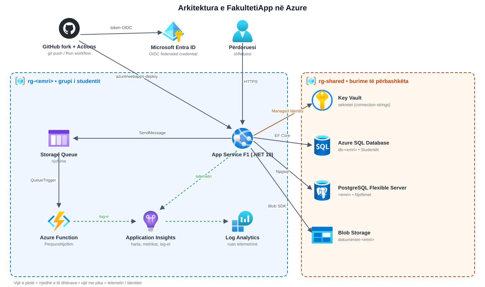

# Programimi në Cloud me Azure: udhëzues i plotë

## Përmbajtja
1. [Qëllimi](#1-qëllimi)
2. [Arkitektura](#2-arkitektura)
3. [Parakushtet](#3-parakushtet-në-kompjuterin-tuaj)
4. [Hapat: krijimi i burimeve një nga një](#4-hapat-krijimi-i-burimeve-një-nga-një)
5. [Burimet në detaje](#5-burimet-në-detaje)
6. [Deploy nga GitHub (OIDC)](#6-deploy-nga-github-me-github-actions-dhe-oidc)
7. [Application Insights: harta dhe metrikat live](#7-application-insights-harta-dhe-metrikat-live)
8. [Siguria](#8-siguria)
9. [Probleme të zakonshme](#9-probleme-të-zakonshme)
10. [Pastrimi pas mësimit](#10-pastrimi-pas-mësimit)
11. [Konfigurime shtesë për produksion](#11-konfigurime-shtesë-për-produksion)

---

## 1. Qëllimi

Ideja e kësaj lënde është **të hostojmë një web app të vërtetë dhe rreth tij të përdorim sa më shumë burime të Azure që përdor një zhvillues (developer) në punën e përditshme**: hosting, databaza relacionale (SQL dhe PostgreSQL), ruajtje skedarësh (Blob), radhë mesazhesh, kod pa server (Function), menaxhim sekretesh (Key Vault), monitorim (Application Insights) dhe deploy i automatizuar nga GitHub pa fjalëkalime (OIDC).

Aplikacioni është një sistem i thjeshtë për Fakultetin e Informatikës (ASP.NET Core MVC, .NET 10, ndërfaqja në shqip). Aplikacioni nuk është qëllimi, por mjeti për të parë se si bashkëveprojnë burimet.

Çfarë do të mësoni:
- si krijohen burimet me **Azure CLI / PowerShell** (si në punën reale, jo vetëm me klikime);
- si lidhet aplikacioni me databazat pa i vendosur fjalëkalimet në kod (Key Vault + Managed Identity);
- si verifikoni në Portal që të dhënat janë vërtet aty;
- si bëhet deploy nga GitHub Actions pa sekrete të gjata (OIDC);
- si monitorohet aplikacioni live.

### Rendi i hapave (përmbledhje)

| # | Hapi | Kush e bën | Skripti / vendi |
|---|---|---|---|
| 0 | Fork, klonim, `az login` | Ju | `gh`, `az` |
| 1 | Web app | Ju | `scripts/setup.ps1` |
| 2 | Databazat dhe container-i | Profesori (të gatshme) | shih `te-dhenat-e-klases.md` |
| 2b | Key Vault-i juaj + sekretet | Ju | `scripts/keyvault-student.ps1` |
| 3 | Lidhja OIDC | Profesori | `new-student-identity.ps1` |
| 4 | Sekretet në GitHub | Ju | GitHub → Settings → Secrets |
| 5 | Deploy | Ju | GitHub → Actions |
| 6–9 | Application Insights, Queue, Function | Ju | Mësimi 2 |

Pas çdo hapi ekzekutoni `./scripts/kontrollo.ps1 -Student emri` për të parë që gjithçka është `[OK]`.

**Respektoni rendin.** Nëse një hap dështon, shihni seksionin [Probleme të zakonshme](#9-probleme-të-zakonshme) para se të vazhdoni.

### Fjalorth i shkurtër (për fillestarë)

| Termi | Në fjalë të thjeshta |
|---|---|
| **Subscription** | "Llogaria e faturimit" ku krijohen burimet (e profesorit) |
| **Resource Group** | Dosje që mban burimet tuaja; ju keni të drejta vetëm në `rg-<emri>` |
| **App Service** | Shërbimi që hoston (ekzekuton) web app-in tuaj në internet |
| **Azure SQL / PostgreSQL** | Dy lloje databazash relacionale në cloud |
| **Blob Storage** | Vend për skedarë (dokumente, foto) |
| **Queue** | Radhë mesazhesh: një pjesë e aplikacionit lë mesazh, tjetra e lexon |
| **Function** | Kod i vogël që ekzekutohet automatikisht kur ndodh një ngjarje |
| **Key Vault** | Kasafortë për fjalëkalime dhe connection string-ë |
| **Managed Identity** | "Identiteti" i web app-it, me të cilin hyn në Key Vault pa fjalëkalim |
| **RBAC / Role** | Të drejtat (p.sh. Contributor = mund të krijojë dhe ndryshojë burime) |
| **OIDC** | Mënyra që GitHub hyn në Azure pa fjalëkalim të ruajtur |
| **Application Insights** | Monitorim: kërkesat, gabimet dhe performanca e aplikacionit |

**Ku i gjej vlerat?** Emrat e serverëve, fjalëkalimet e databazave dhe komandën e Key Vault: [te-dhenat-e-klases.md](te-dhenat-e-klases.md). Çelësin e Storage (`-StorageKey`) e jep profesori në klasë.

**Çfarë do të keni në fund:** një web app në internet me adresë `https://app-<emri>-xxxxx.azurewebsites.net`, që lexon studentët nga SQL, njoftimet nga PostgreSQL, ngarkon dokumente në Blob dhe monitorohet në Application Insights.

## 2. Arkitektura



| Zona | Kuptimi |
|---|---|
| Kuti blu `rg-<emri>` | Grupi i resurseve të studentit: ju keni leje të plota (Contributor) |
| Kuti portokalli `rg-shared` | Burime të përbashkëta, të krijuara nga profesori; secili student ka databazën/container-in e vet |

### Çfarë është e përbashkët dhe çfarë e krijoni ju

| | **E përbashkët** (`rg-shared`, e krijon profesori) | **Individuale** (`rg-<emri>`, e krijoni ju) |
|---|---|---|
| Databazat | SQL server dhe PostgreSQL server (një për të gjithë) | **Databaza juaj** brenda tyre: `db-<emri>` (SQL) dhe `<emri>` (PostgreSQL) |
| Skedarët | Storage account | **Container-i juaj** `dokumentet-<emri>` |
| Hosting | – | App Service plan dhe web app |
| Sekretet | – | Key Vault `kv-<emri>-xxxxx` |
| Monitorimi | – | Application Insights dhe Log Analytics |
| Queue dhe Function | – | Storage account, queue `njoftime`, Function app |
| Deploy | – | Forku juaj në GitHub dhe identiteti OIDC |

**Pse ashtu?**
- **SQL dhe PostgreSQL janë të përbashkët** sepse serverët janë burimet më të shtrenjta dhe më të ngadalta për t'u krijuar (PostgreSQL kushton edhe kur s'përdoret; SQL ka kufi falas vetëm për 10 databaza në subscription). Një server për klasën kursen para dhe kohë, ndërsa secili ka databazën e vet, kështu që s'ngatërroheni me njëri-tjetrin.
- **Storage i përbashkët**: një account, por container i veçantë për secilin.
- **Web app, Key Vault, App Insights dhe Function janë individuale** sepse ato janë pjesa që duhet të mësoni ta krijoni vetë, janë falas ose shumë të lira, dhe ju keni të drejta Contributor vetëm në `rg-<emri>`. Në `rg-shared` nuk keni qasje.
- **Key Vault është individual** që të provoni vetë sekretet, Managed Identity dhe rolet (RBAC), pa varësi nga profesori.

Kujdes: serverët e përbashkët përdorin një admin të vetëm (`dbadmin`), prandaj në prodhim çdo aplikacion do të kishte përdoruesin e vet. Këtu është e thjeshtuar për demo.

**Kontrolloni progresin në çdo kohë:** `./scripts/kontrollo.ps1 -Student emri` tregon me `[OK]` / `[MUNGON]` çfarë keni krijuar dhe çfarë të bëni më tej.

### Rrjedha e të dhënave
1. Përdoruesi hap web app-in (App Service) me HTTPS.
2. *Studentët* ruhen në **Azure SQL** (tabela `Studentet`), dokumenti ngarkohet në **Blob Storage**.
3. *Njoftimet* ruhen në **PostgreSQL** (tabela `Njoftimet`).
4. Kur shtohet student, web app dërgon mesazh në **Storage Queue** `njoftime`.
5. **Azure Function** aktivizohet nga radha dhe shkruan log-un në **Application Insights**.
6. Web app-i i merr fjalëkalimet nga **Key Vault** përmes Managed Identity (nuk ka fjalëkalime në kod).

### Rrjedha e deploy-it
`git push` / *Run workflow* → GitHub Actions → login në Azure me **OIDC** (Entra ID) → `azure/webapps-deploy` → web app.

## 3. Parakushtet në kompjuterin tuaj

| Mjeti | Instalimi | Kontrolli |
|---|---|---|
| Llogari GitHub | https://github.com | — |
| Git | https://git-scm.com/downloads | `git --version` |
| GitHub CLI | https://cli.github.com | `gh --version`, pastaj `gh auth login` |
| Azure CLI | https://aka.ms/installazurecliwindows | `az --version` |
| PowerShell 7 (rekomandohet) | https://aka.ms/powershell | `pwsh --version` |
| .NET 10 SDK | https://dotnet.microsoft.com/download/dotnet/10.0 | `dotnet --version` (fillon me `10.`) |
| Python 3 | https://www.python.org/downloads | `python --version` |
| VS Code | https://code.visualstudio.com (C# Dev Kit, PowerShell) | — |

Duhet qasje te `*.azure.com`, `github.com` dhe `nuget.org`.

**Të dhënat e përbashkëta** (përdoren në të gjitha komandat):

| Emri | Vlera |
|---|---|
| Tenant | `e7dd866d-a284-43a6-90aa-9aad6684a2f0` |
| Subscription | `9f0f210c-952d-4f87-a34a-0f7c1f6a3dcb` |
| Grupi juaj | `rg-<emri>` (emri i vogël: ardian, arjeta, clirim, faton, shefki) |
| Grupi i përbashkët | `rg-shared` |

## 4. Hapat: krijimi i burimeve një nga një

Çdo hap ka dy pjesë: **komanda** dhe **verifikimi në Azure Portal** (https://portal.azure.com). Në Portal përdorni kërkimin lart për të gjetur burimin ose hyni te **Resource groups → rg-<emri>**.

### Hapi 0: Fork, klonim dhe hyrja në Azure
```powershell
gh auth login
gh repo fork fisko/FakultetiApp --clone
cd FakultetiApp
az login --tenant e7dd866d-a284-43a6-90aa-9aad6684a2f0
az account set --subscription 9f0f210c-952d-4f87-a34a-0f7c1f6a3dcb
az account show
```
**Verifikim:** `az account show` duhet të shfaqë subscription `9f0f210c-...`. Në Portal hapni *Resource groups* dhe duhet të shihni `rg-<emri>`.

### Hapi 1: Web app (App Service)
```powershell
./scripts/setup.ps1 -Student emri
```
Skripti bën këto:
- krijon **App Service Plan** `plan-<emri>` (B1, Basic, Linux);
- krijon **Web App** `app-<emri>-xxxxx` (.NET 10);
- aktivizon **Managed Identity** të web app-it;
- vendos emrin e container-it Blob (`Blob__Container`).

Connection string-ët i vendos hapi 2b. Në fund skripti shfaq `APP_NAME`. **Shënojeni**, do ta përdorni në GitHub.

Dalja e pritur (fundi): `== GATI ==`, `Web app: app-<emri>-xxxxx`.

**Verifikim në Portal:** `rg-<emri>` → duhet të shihni *App Service plan* dhe *App Service*. Hapni App Service-in → **Overview → Default domain**. Faqja do të tregojë faqen bosh të Azure (nuk ka deploy ende).

### Hapi 2: Databazat, container-i dhe sekretet (e bën profesori)
Databazat, container-i dhe sekretet janë krijuar paraprakisht nga profesori; emrat dhe fjalëkalimet janë te [te-dhenat-e-klases.md](te-dhenat-e-klases.md). Skripti i profesorit krijon:
- databazën SQL `db-<emri>` në serverin e përbashkët;
- databazën PostgreSQL `<emri>` në serverin e përbashkët;
- Blob container `dokumentet-<emri>`;
- rolet tuaja në `rg-<emri>` (Contributor, Key Vault Administrator, User Access Administrator), që ju të krijoni Key Vault-in tuaj.

Këtu nuk bëni asgjë, vetëm verifikoni.

**Verifikim në Portal:**
- *rg-shared → SQL server → SQL databases*: shihni `db-<emri>`.
- *rg-shared → PostgreSQL server → Databases*: shihni `<emri>`.
- *rg-shared → Storage account → Data storage → Containers*: shihni `dokumentet-<emri>`.

### Hapi 2b: Key Vault-i juaj (e bëni ju)
Key Vault-i ruan connection string-ët; ky skript e krijon dhe e lidh me web app-in. Merrni fjalëkalimet nga [te-dhenat-e-klases.md](te-dhenat-e-klases.md) dhe çelësin e Storage nga profesori. Skripti:
- krijon `kv-<emri>-xxxxx` (me RBAC);
- vendos 3 sekrete: `SqlConnection`, `PostgresConnection`, `StorageConnection`;
- i jep web app-it leje *Key Vault Secrets User* dhe vendos referencat `@Microsoft.KeyVault(...)` te App settings;
- e rinis (restart) web app-in.

Mund të presë 1–5 minuta që lejet të përhapen; skripti provon automatikisht, mos e ndërprisni.
```powershell
./scripts/keyvault-student.ps1 -Student emri -SqlPassword "..." -PgPassword "..." -StorageKey "..."
```
**Verifikim në Portal:** `rg-<emri>` → Key Vault `kv-<emri>-xxxxx` → *Objects → Secrets* (3 sekrete). Pastaj web app → *Settings → Environment variables*: te `ConnectionStrings__Sql` duhet **Key Vault Reference: Resolved** (gjelbër). Nëse del e kuqe, prisni 2 minuta dhe bëni *Restart*.

### Hapi 3: Lidhja OIDC (e bën profesori)
Jepini profesorit emrin tuaj të përdoruesit në GitHub. Ai ekzekuton `new-student-identity.ps1`, që krijon një **App Registration** `gh-deploy-<emri>`, një **federated credential** për forkun tuaj (vetëm dega `main`) dhe rolin *Contributor* në `rg-<emri>`. Ju jep `AZURE_CLIENT_ID`.

**Verifikim në Portal:** *Microsoft Entra ID → App registrations → All applications → gh-deploy-<emri> → Certificates & secrets → Federated credentials*. Shihni *Subject identifier* që përmban forkun tuaj.

### Hapi 4: Sekretet në GitHub
Në fork: **Settings → Secrets and variables → Actions → New repository secret**:

| Sekreti | Vlera |
|---|---|
| `AZURE_CLIENT_ID` | jepet nga profesori |
| `AZURE_TENANT_ID` | `e7dd866d-a284-43a6-90aa-9aad6684a2f0` |
| `AZURE_SUBSCRIPTION_ID` | `9f0f210c-952d-4f87-a34a-0f7c1f6a3dcb` |
| `APP_NAME` | emri i web app-it nga hapi 1 |

Ose me CLI:
```powershell
gh secret set AZURE_CLIENT_ID --body "<vlera>"
gh secret set AZURE_TENANT_ID --body "e7dd866d-a284-43a6-90aa-9aad6684a2f0"
gh secret set AZURE_SUBSCRIPTION_ID --body "9f0f210c-952d-4f87-a34a-0f7c1f6a3dcb"
gh secret set APP_NAME --body "<app-name>"
```
**Verifikim:** `gh secret list` duhet të shfaqë 4 sekrete. (Vlerat nuk shihen kurrë më pas; kjo është normale.)

### Hapi 5: Deploy
**Actions → Deploy në Azure → Run workflow** (ose `git push`).

**Verifikim:**
- Në GitHub, workflow-i bëhet jeshil.
- Në Portal: *App Service → Deployment → Deployment Center → Logs* shfaq deploy-in e fundit.
- Hapni `https://<APP_NAME>.azurewebsites.net`: duhet të shihni aplikacionin në shqip. Shtoni një student dhe një njoftim.

#### Çfarë të shihni në Portal pas deploy-it
Hapni https://portal.azure.com → grupi `rg-<emri>` dhe kontrolloni një nga një:

| Ku në Portal | Çfarë të shihni | Çfarë ju mëson |
|---|---|---|
| `rg-<emri>` → **Overview** | Lista e burimeve: App Service Plan, Web App, Key Vault (+ Application Insights, Storage, Function nëse i keni bërë) | Gjithçka që keni krijuar jetron në një grup |
| Web App → **Overview** | *Status: Running*, *Default domain* (linku i aplikacionit), *Runtime: .NET 10* | Aplikacioni është online; klikoni linkun për ta hapur |
| Web App → **Deployment → Deployment Center → Logs** | Rreshti i fundit me statusin *Success* dhe commit-in nga GitHub | Lidhja GitHub → Azure me OIDC funksionoi |
| Web App → **Settings → Environment variables** | `ConnectionStrings__Sql`, `__Postgres`, `__Storage` me statusin **Key Vault Reference: Resolved** (ikona jeshile) | Fjalëkalimet vijnë nga Key Vault, jo nga kodi |
| Web App → **Settings → Identity** | *System assigned: On* me një Object ID | Identiteti me të cilin web app-i hyn në Key Vault |
| Web App → **Monitoring → Log stream** | Regjistrat live; hapni faqen e aplikacionit dhe shihni kërkesat | Çfarë po ndodh brenda aplikacionit |
| Key Vault → **Objects → Secrets** | `SqlConnection`, `PostgresConnection`, `StorageConnection` | Këtu janë ruajtur sekretet |
| Key Vault → **Access control (IAM) → Role assignments** | Web app-i me rolin *Key Vault Secrets User* | Lejet jepen me role, vetëm për lexim |
| `rg-shared` → SQL server → databaza `db-<emri>` → **Query editor** | `SELECT * FROM Studentet;` shfaq studentin që shtuat | Të dhënat u ruajtën në Azure SQL |
| `rg-shared` → PostgreSQL `psql-fakulteti-qzpml` → **Settings → Databases** (të dhënat me `psql` ose VS Code) | Databaza `<emri>`; me `psql`: `SELECT * FROM "Njoftimet" ORDER BY "Data" DESC;` shfaq njoftimin që shtuat | Të dhënat u ruajtën në PostgreSQL (Portal nuk ka Query editor për të; shih 5.5) |
| `rg-shared` → Storage `stfakultetif7k2q` → **Containers → dokumentet-<emri>** | Skedari që ngarkuat nga aplikacioni | Blob Storage |
| `rg-<emri>` → **Access control (IAM)** → Role assignments | Identiteti `gh-deploy-<emri>` me rolin *Contributor* | Kush mund të bëjë deploy në grupin tuaj |
| Microsoft Entra ID → **App registrations** → `gh-deploy-<emri>` → **Certificates & secrets → Federated credentials** | Credential me `repo:<github-user>/FakultetiApp:ref:refs/heads/main` | Pse GitHub hyn pa fjalëkalim |
| GitHub → **Actions** → workflow-i i fundit | Hapat jeshilë: build, login (OIDC), deploy | Rrjedha e plotë CI/CD |

Mund të ekzekutoni edhe `./scripts/kontrollo.ps1 -Student <emri>` për të kontrolluar automatikisht shumicën e këtyre.

### Hapi 6: Application Insights
```powershell
$s   = "emri"
$rg  = "rg-$s"
$loc = "eastus"
$app = az webapp list -g $rg --query "[0].name" -o tsv

az monitor log-analytics workspace create -g $rg -n "log-$s" -l $loc
az monitor app-insights component create -g $rg -a "appi-$s" -l $loc --workspace "log-$s" --kind web
$ai = az monitor app-insights component show -g $rg -a "appi-$s" --query connectionString -o tsv
@{ APPLICATIONINSIGHTS_CONNECTION_STRING = $ai } | ConvertTo-Json | Set-Content ai.json
az webapp config appsettings set -g $rg -n $app --settings "@ai.json"
Remove-Item ai.json
```
Nëse komanda kërkon, regjistroni providerët: `az provider register -n Microsoft.OperationalInsights` dhe `az provider register -n microsoft.insights`.

**Verifikim në Portal:** `rg-<emri>` ka tani *Log Analytics workspace* dhe *Application Insights*. Hapni `appi-<emri>` → **Overview** dhe te *Configure → Properties* shihni *Workspace* të lidhur me `log-<emri>`. Në web app → *Environment variables* shihni `APPLICATIONINSIGHTS_CONNECTION_STRING`.

### Hapi 7: Storage account dhe Queue
```powershell
$sfx = -join ((1..5) | % { 'abcdefghijklmnopqrstuvwxyz0123456789'[(Get-Random -Max 36)] })
$st  = "stfn$s$sfx"
az storage account create -g $rg -n $st -l $loc --sku Standard_LRS --allow-blob-public-access false
$conn = az storage account show-connection-string -g $rg -n $st --query connectionString -o tsv
az storage queue create --name njoftime --connection-string $conn
@{ "ConnectionStrings__Queue" = $conn } | ConvertTo-Json | Set-Content q.json
az webapp config appsettings set -g $rg -n $app --settings "@q.json"
Remove-Item q.json
```
**Verifikim në Portal:** *Storage account → Data storage → Queues*: shihni `njoftime`. Hapni queue-n dhe shtypni *Add message* për test.

### Hapi 8: Azure Function
```powershell
az provider register -n Microsoft.App
$fn = "func-$s-$sfx"
az functionapp create -g $rg -n $fn --storage-account $st --flexconsumption-location $loc --runtime dotnet-isolated --runtime-version 10 --instance-memory 512 --maximum-instance-count 40
@{ QueueConnection = $conn; APPLICATIONINSIGHTS_CONNECTION_STRING = $ai } | ConvertTo-Json | Set-Content fn.json
az functionapp config appsettings set -g $rg -n $fn --settings "@fn.json"
Remove-Item fn.json
./scripts/deploy-function.ps1 -Student $s -FunctionApp $fn
```
**Verifikim në Portal:** *Function App → Overview → Functions*: shfaqet `PerpunoNjoftim`. Hapni funksionin → **Invocations** për ekzekutimet.

### Hapi 9: Provë e plotë
1. Hapni web app-in → *Studentët → Shto* një student (me dokument, nëse dëshironi).
2. Pas ~1 minute, *Function App → PerpunoNjoftim → Invocations* shfaq ekzekutimin.
3. *appi-<emri> → Logs* dhe ekzekutoni: `traces | where message has "U pranua" | order by timestamp desc`.

## 5. Burimet në detaje

Për secilin burim: **çfarë është**, **si e përdorim**, **çfarë konfigurimesh të shihni në Portal**, **si i verifikoni të dhënat**.

### 5.1 Resource Group
- **Çfarë është:** kontejner logjik për burimet që kanë të njëjtin cikël jete. Fshirja e grupit fshin gjithçka brenda.
- **Si e përdorim:** `rg-<emri>` për burimet tuaja, `rg-shared` për të përbashkëtat.
- **Çfarë të shihni:** *Overview* (lista e burimeve), **Access control (IAM) → Role assignments** (kush ka akses; ju: Contributor, identiteti `gh-deploy-<emri>`: Contributor), **Deployments**, **Tags**.
- **CLI:** `az resource list -g rg-<emri> -o table`

### 5.2 App Service (web app)
- **Çfarë është:** hosting i menaxhuar për aplikacione web (PaaS); s'keni nevojë për server.
- **Si e përdorim:** ekzekuton aplikacionin MVC. Plani **B1** (Basic) ka pagesë të vogël por nuk bllokohet; F1 (falas) ka kuotë 60 min CPU/ditë dhe web app-i çaktivizohet kur kalohet (gabimi *Site Disabled 403*).
- **Çfarë të shihni në Portal:**
  - *Overview*: URL, statusi, plani.
  - **Settings → Environment variables → App settings**: `ConnectionStrings__Sql`, `__Postgres`, `__Storage`, `__Queue`, `Blob__Container`, `APPLICATIONINSIGHTS_CONNECTION_STRING`. Referencat Key Vault shfaqen me statusin *Resolved*.
  - **Settings → Identity → System assigned**: *Status = On*, shihni *Object (principal) ID*. Ky identitet lexon Key Vault.
  - **Settings → Configuration → Stack settings**: .NET 10.
  - **Deployment → Deployment Center**: historiku i deploy-eve.
  - **Monitoring → Log stream**: log-et live të aplikacionit.
  - **Development Tools → SSH** (ose Advanced Tools/Kudu): shfaqja e skedarëve të deploy-uar.
- **Verifikim:** hapni URL-në; `az webapp log tail -g rg-<emri> -n <APP_NAME>` për log-et.

### 5.3 Key Vault
- **Çfarë është:** ruajtje e sigurt e sekreteve (connection strings, fjalëkalime, çelësa).
- **Si e përdorim:** web app-i lexon sekretet me referencë `@Microsoft.KeyVault(VaultName=...;SecretName=<emri>-SqlConnection)`. Kodi sheh vetëm një *environment variable* të zakonshme.
- **Çfarë të shihni në Portal:**
  - **Objects → Secrets**: emrat e sekreteve (vlerën e sheh vetëm kush ka rol *Key Vault Secrets User/Officer*).
  - **Access control (IAM)**: modeli RBAC; shihni *Role assignments* për identitetin e web app-it në secilin sekret.
  - **Networking**: *Public access*.
  - **Monitoring → Diagnostic settings**: ku dërgohen log-et e aksesit.
- **Verifikim:** `az keyvault secret list --vault-name kv-fakulteti-f7k2q -o table` dhe `az keyvault secret show --vault-name kv-fakulteti-f7k2q -n <emri>-SqlConnection --query value -o tsv` (vetëm nëse keni leje; profesori e ka).

### 5.4 Azure SQL Database
- **Çfarë është:** SQL Server i menaxhuar (T-SQL). Përdor Entity Framework Core nga aplikacioni.
- **Si e përdorim:** databaza `db-<emri>` në serverin e përbashkët; tabela `Studentet` (Id, Emri, Mbiemri, Email, Viti, DokumentiUrl). Niveli *Serverless* me *free offer* (auto-pause).
- **Çfarë të shihni në Portal:**
  - *SQL database → Overview*: server, status (Online/Paused).
  - **Settings → Connection strings**: formati ADO.NET (krahasojeni me sekretin në Key Vault).
  - **Compute + storage**: *Serverless*, *Auto-pause delay*, free offer.
  - *SQL server → Security → Networking*: **Firewall rules** (në klasë është lejuar çdo IP; **mos e bëni kështu në prodhim**).
  - **Query editor (preview)**: kyçuni me `dbadmin` dhe fjalëkalimin që jep profesori.
- **Verifikim të dhënash:** në *Query editor*:
  ```sql
  SELECT * FROM Studentet;
  SELECT COUNT(*) FROM Studentet;
  ```
  Ose me `sqlcmd`/Azure Data Studio/VS Code (SQL Server extension).
  Shënim: nëse databaza është *paused*, lidhja e parë zgjat ~1 minutë.

### 5.5 Azure Database for PostgreSQL (Flexible Server)
- **Çfarë është:** PostgreSQL i menaxhuar (open-source).
- **Si e përdorim:** databaza `<emri>` në serverin e përbashkët; tabela `"Njoftimet"` (Id, Titulli, Permbajtja, Data). Aplikacioni lidhet me Npgsql.
- **Çfarë të shihni në Portal:**
  - *Overview*: host (`psql-fakulteti-...postgres.database.azure.com`), versioni, statusi (**Stop/Start**).
  - **Settings → Databases**: databazat e studentëve.
  - **Settings → Networking**: firewall rules dhe *Allow public access*.
  - **Settings → Connect**: shembuj lidhjeje (psql, .NET, etj.).
  - **Settings → Server parameters**: p.sh. `max_connections`.
  - **Compute + storage**: B1ms (Burstable). **Ky burim kushton, ndalojeni pas mësimit.**
- **Verifikim të dhënash:**
  ```powershell
  psql "host=psql-fakulteti-qzpml.postgres.database.azure.com dbname=<emri> user=dbadmin sslmode=require"
  ```
  ```sql
  SELECT * FROM "Njoftimet" ORDER BY "Data" DESC;
  \dt
  ```
  Ose me VS Code (PostgreSQL extension) / pgAdmin / DBeaver. Kujdes: emrat e tabelave e kolonave janë me shkronja të mëdha, prandaj kërkojnë thonjëza.

### 5.6 Storage Account: Blob
- **Çfarë është:** ruajtje objektesh (skedarë, imazhe, dokumente).
- **Si e përdorim:** container `dokumentet-<emri>`; web app-i ngarkon dokumentin e studentit dhe ruan URL-në në `Studentet.DokumentiUrl`.
- **Çfarë të shihni në Portal:**
  - **Data storage → Containers → dokumentet-<emri>**: skedarët e ngarkuar; klikoni një skedar për *URL*, *Size*, *Content type*.
  - **Security + networking → Access keys / Networking**: çelësat dhe aksesi publik.
  - **Data management → Redundancy**: LRS/GRS.
  - **Storage browser**: shfletim i blob-eve, queue-ve.
- **Verifikim:**
  ```powershell
  $stgKey = az storage account keys list -n stfakultetif7k2q -g rg-shared --query "[0].value" -o tsv
  az storage blob list --container-name dokumentet-<emri> --account-name stfakultetif7k2q --account-key $stgKey -o table
  ```
  Hapni URL-në e blob-it në shfletues për të parë skedarin.

### 5.7 Storage Queue
- **Çfarë është:** radhë e thjeshtë mesazhesh për komunikim asinkron midis komponentëve.
- **Si e përdorim:** web app-i dërgon "Student i ri: Emri Mbiemri" në radhën `njoftime`; Function-i e konsumon.
- **Çfarë të shihni në Portal:** *Storage account → Data storage → Queues → njoftime* (mesazhet, *Dequeue count*, *Expiration time*). Nëse ka `njoftime-poison`, atje shkojnë mesazhet që dështuan disa herë.
- **Verifikim:**
  ```powershell
  az storage message peek -q njoftime --connection-string $conn -o table
  az storage message put  -q njoftime --content "Përshëndetje" --connection-string $conn
  ```
  Kur Function-i punon, radha është zakonisht bosh (mesazhet merren menjëherë).

### 5.8 Azure Function (Flex Consumption)
- **Çfarë është:** kod që ekzekutohet kur ndodh një ngjarje, pa server (serverless). Paguhet sipas përdorimit.
- **Si e përdorim:** `PerpunoNjoftim` (QueueTrigger në `njoftime`) shkruan log-un në Application Insights.
- **Çfarë të shihni në Portal:**
  - *Overview → Functions*: lista e funksioneve.
  - **PerpunoNjoftim → Invocations**: çdo ekzekutim, kohëzgjatja, sukses/dështim (mund të vonojë disa minuta).
  - **Settings → Environment variables**: `QueueConnection`, `APPLICATIONINSIGHTS_CONNECTION_STRING`.
  - **Settings → Scale and concurrency** (Flex): *Maximum instance count*, *Instance memory*.
  - **Monitoring → Log stream / Application Insights**.
- **Verifikim:** `traces | where message has "U pranua"` në Application Insights → Logs.

### 5.9 Application Insights dhe Log Analytics
- **Çfarë është:** shërbim monitorimi (APM). *Log Analytics workspace* është vendi ku ruhen të dhënat; Application Insights i analizon.
- **Si e përdorim:** web app-i dhe Function dërgojnë kërkesat (requests), varësitë (SQL, PostgreSQL, Blob, Queue), përjashtimet dhe log-et.
- **Çfarë të shihni në Portal:** shih seksionin [7](#7-application-insights-harta-dhe-metrikat-live).
- **Konfigurime:** *Configure → Properties* (workspace, connection string), *Usage and estimated costs → Data Cap* (kufizim kostoje), *Configure → Retention*.

### 5.10 Microsoft Entra ID (OIDC)
- **Çfarë është:** shërbimi i identitetit të Azure. Këtu krijohet identiteti që GitHub Actions përdor për të bërë deploy.
- **Si e përdorim:** **federated credential**: Azure beson tokenin që GitHub jep për forkun tuaj (`repo:<ju>/FakultetiApp`, dega `main`). Nuk ka fjalëkalim për t'u ruajtur ose rrjedhur.
- **Çfarë të shihni në Portal:** *Entra ID → App registrations → gh-deploy-<emri>*: **Overview** (Application (client) ID = `AZURE_CLIENT_ID`), **Certificates & secrets → Federated credentials**; dhe te *rg-<emri> → Access control (IAM)* rolin Contributor.

## 6. Deploy nga GitHub me GitHub Actions dhe OIDC

Skedari `.github/workflows/deploy.yml` (i thjeshtuar):
```yaml
on:
  push: { branches: [main] }
  workflow_dispatch:
permissions:
  id-token: write      # e nevojshme për OIDC
  contents: read
jobs:
  deploy:
    runs-on: ubuntu-latest
    steps:
      - uses: actions/checkout@v4
      - uses: actions/setup-dotnet@v4
        with: { dotnet-version: 10.0.x }
      - run: dotnet publish src/FakultetiApp.csproj -c Release -o publish
      - uses: azure/login@v2
        with:
          client-id: ${{ secrets.AZURE_CLIENT_ID }}
          tenant-id: ${{ secrets.AZURE_TENANT_ID }}
          subscription-id: ${{ secrets.AZURE_SUBSCRIPTION_ID }}
      - uses: azure/webapps-deploy@v3
        with:
          app-name: ${{ secrets.APP_NAME }}
          package: publish
```
Si funksionon:
1. Actions kërkon nga GitHub një **token OIDC** afatshkurtër (kjo kërkon `id-token: write`).
2. `azure/login` ia paraqet tokenin Entra ID. Entra kontrollon që *subject* përputhet me federated credential (repo + degë).
3. Entra jep token Azure për identitetin `gh-deploy-<emri>`, me të drejta vetëm në `rg-<emri>`.
4. `webapps-deploy` ngarkon paketën te web app-i juaj.

> Federated credential lejon vetëm degën `main`. Nëse nisni workflow nga tag ose degë tjetër, hyrja në Azure dështon.

## 7. Application Insights: harta dhe metrikat live

Hapni **Portal → rg-<emri> → appi-<emri>**. Gjeneroni trafik: hapni web app-in, shtoni studentë e njoftime, rifreskoni faqet disa herë.

| Funksioni | Ku gjendet | Çfarë shihni |
|---|---|---|
| **Application Map** | *Investigate → Application map* | Harta e komponentëve: web app → SQL, PostgreSQL, Blob, Queue; Function-i. Çdo kuti tregon numrin e thirrjeve, kohën mesatare dhe përqindjen e dështimeve. Klikoni një shigjetë (p.sh. drejt SQL) për detaje. |
| **Live Metrics** | *Investigate → Live metrics* | Kërkesa/sekondë, kohëzgjatja, dështimet, CPU/memoria, dhe lista e kërkesave **në kohë reale** (vonesa ~1 sek). Rifreskoni web app-in dhe shikoni kërkesat të shfaqen. |
| **Transaction search** | *Investigate → Transaction search* | Kërkesa individuale, përjashtime, trace-t. Klikoni një kërkesë për *End-to-end transaction*: gjithë zinxhirin (kërkesa → SQL → radha). |
| **Performance** | *Investigate → Performance* | Operacionet më të ngadalta (p.sh. `GET /Studentet`) dhe varësitë. |
| **Failures** | *Investigate → Failures* | Kërkesat dhe varësitë e dështuara, me përjashtimet. |
| **Availability** | *Investigate → Availability* | Test ping nga jashtë (opsional). |
| **Metrics** | *Monitoring → Metrics* | Grafikë: *Server response time*, *Server requests*, *Failed requests*. |
| **Logs (KQL)** | *Monitoring → Logs* | Pyetje të lira. |

Shembuj KQL (te *Logs*):
```kusto
// kërkesat e 30 minutave të fundit sipas faqes
requests
| where timestamp > ago(30m)
| summarize numri = count(), mesatarja_ms = avg(duration) by name
| order by numri desc

// thirrjet drejt databazave dhe Storage
dependencies
| where timestamp > ago(30m)
| summarize numri = count(), mesatarja_ms = avg(duration) by type, target

// mesazhet e Function-it
traces
| where message has "U pranua"
| order by timestamp desc
| take 20

// përjashtimet
exceptions | order by timestamp desc | take 20
```
> Të dhënat e para mund të shfaqen pas 2 – 5 minutash; *Live Metrics* është menjëherë.
> Nëse harta është bosh: kontrolloni që `APPLICATIONINSIGHTS_CONNECTION_STRING` është te web app-i dhe bëni *Restart*.

## 8. Siguria
- Sekretet jetojnë në **Key Vault**, jo në kod; web app-i i lexon me Managed Identity.
- Deploy-i përdor **OIDC**, pa fjalëkalime të ruajtura në GitHub. Në GitHub ruhen vetëm identifikues (client id, tenant, subscription), që nuk janë sekrete të vërteta.
- Çdo student ka leje vetëm në grupin e vet dhe vetëm në sekretet e veta.
- **Kujdes (vetëm për klasë):** firewall-et e databazave lejojnë çdo IP (`0.0.0.0 – 255.255.255.255`) dhe aplikacioni përdor administratorin e serverit. Në prodhim përdoret: firewall i ngushtë ose *Private Endpoint*, përdorues me të drejta minimale ose **Entra ID authentication**.
- Kurrë mos bëni commit të connection string-ave ose fjalëkalimeve.

## 9. Probleme të zakonshme

| Problem | Zgjidhje |
|---|---|
| `az login` hap tenant tjetër | `az login --tenant e7dd866d-a284-43a6-90aa-9aad6684a2f0` |
| `MissingSubscriptionRegistration` | `az provider register -n <Provider>` dhe prisni 1–2 min |
| Emri i web app / storage ekziston | Emrat janë globalë; ndryshoni prapashtesën |
| Key Vault reference nuk zgjidhet (e kuqe) Ekzekutoni `keyvault-student.ps1` (hapi 2b); nëse e keni bërë, prisni 2–5 min për lejet dhe bëni *Restart* te web app |
| `keyvault-student.ps1`: Forbidden / AuthorizationFailed | Lejet ende po përhapen; skripti provon vetë. Nëse vazhdon, njoftoni profesorin |
| `azure/login` dështon (AADSTS70021) | Workflow nuk nisi nga `main` ose emri i forkut s'përputhet me credential |
| SQL: lidhja e parë dështon/ngadalëson | Databaza ishte në pauzë; provoni përsëri pas 1 min |
| `psql`: tabela nuk gjendet | Përdorni thonjëza: `"Njoftimet"` |
| Mesazhi shkon te `njoftime-poison` | `host.json` duhet të ketë `"messageEncoding": "none"` |
| App Insights bosh | Prisni 2–5 min, kontrolloni connection string, bëni Restart |
| Web app: 500 pas deploy | *Monitoring → Log stream* dhe *Failures* në App Insights |

## 10. Pastrimi pas mësimit
- **PostgreSQL kushton**; profesori e ndalon: `./scripts/cleanup.ps1 -Student emri -StopOnly`.
- Për të fshirë burimet tuaja: `az group delete -n rg-<emri> --yes --no-wait` (fshin gjithçka në grupin tuaj; databazat në `rg-shared` i fshin profesori).
- Verifikim: *Portal → Resource groups*; grupi nuk duhet të ekzistojë më.

## 11. Konfigurime shtesë për produksion

Ky mjedis është për mësim: është i thjeshtë dhe pa kosto. Një aplikacion i vërtetë kërkon këto ndryshime shtesë.

| Fusha | Në klasë | Në produksion |
|---|---|---|
| **Rrjeti i databazave** | Firewall i hapur për çdo IP | Firewall i ngushtë ose **Private Endpoint** + VNet integration te web app |
| **Hyrja në databazë** | Admini `dbadmin` me fjalëkalim | **Entra ID authentication** me Managed Identity; përdorues me të drejta minimale (vetëm lexim/shkrim në tabelat e veta) |
| **Storage** | Çelës llogarie (`AccountKey`) dhe container publik (`blob`) | Managed Identity + rolet *Storage Blob Data Contributor*, container privat, linke SAS me afat |
| **Key Vault** | Aksesi publik | Firewall/Private Endpoint, **soft delete + purge protection**, rotacion i sekreteve, alarme |
| **Plani i App Service** | B1 (Basic, pa SLA, pa Always On) | P0v3 ose më lart, **Always On**, **autoscale**, **deployment slots** (staging → swap) |
| **Databaza SQL** | Serverless me pauzë automatike | Nivel i caktuar (vCore/DTU), **backup dhe point-in-time restore**, geo-replikim sipas nevojës |
| **PostgreSQL** | B1ms, pa HA | General Purpose me **High Availability**, backup me retention më të gjatë |
| **HTTPS dhe domeni** | `*.azurewebsites.net` | Domen i vetin, certifikatë e menaxhuar, **HTTPS Only**, TLS 1.2+, HSTS |
| **Monitorimi** | Application Insights bazë | **Alerts** (gabime 5xx, koha e përgjigjes, CPU), dashboards, retention e logeve, Availability tests |
| **CI/CD** | Deploy direkt në `main` | Mjedise (dev/test/prod), **GitHub Environments** me miratim manual, testime automatike, branch protection |
| **Infrastruktura** | Skripta PowerShell/CLI | **Infrastructure as Code** (Bicep ose Terraform) në repo |
| **Qeverisja** | Contributor te grupi | Princip i privilegjit minimal, **Azure Policy**, tags, buxhet dhe alarme kostoje, resource locks |
| **Siguria e aplikacionit** | Aplikacion demonstrues | Validim i të dhënave, autentikim/autorizim (Entra ID), CORS, **Defender for Cloud**, skanim varësish (Dependabot) |
| **Ruajtja e fjalëkalimeve** | Në `te-dhenat-e-klases.md` (vetëm demo) | Kurrë në repo; vetëm Key Vault; rotacion pas çdo ekspozimi |

**Hapi i parë i rekomanduar në praktikë:** hiqni fjalëkalimin e adminit dhe çelësin e Storage, dhe kaloni në Managed Identity.

## Shtojca: struktura e repo-s
```
src/                    aplikacioni ASP.NET Core MVC
functions/              Azure Function (QueueTrigger)
scripts/                setup.ps1, keyvault-student.ps1, kontrollo.ps1 (studenti);
                        setup-shared.ps1, provision-student.ps1, new-student-identity.ps1, cleanup.ps1 (profesori);
                        deploy-function.ps1
docs/                   dokumentacioni (ky skedar) dhe img/arhitektura.svg
.github/workflows/      deploy.yml
```
