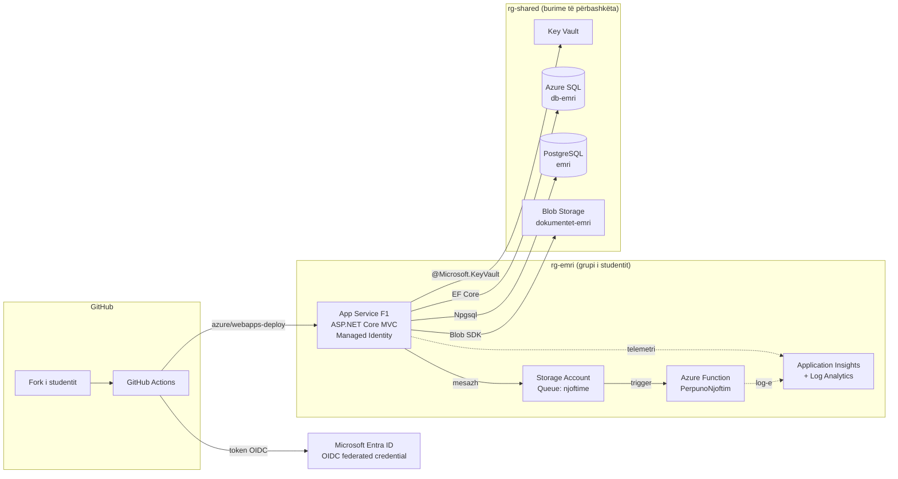

# Programimi në Cloud me Azure: udhëzues i plotë

Aplikacioni **FakultetiApp** (ASP.NET Core MVC, .NET 10) për Fakultetin e Informatikës: nga GitHub te Azure, hap pas hapi.

## Përmbajtja
1. [Qëllimi](#1-qëllimi)
2. [Arkitektura](#2-arkitektura)
3. [Burimet në Azure](#3-burimet-në-azure-dhe-si-i-përdorim)
4. [Parakushtet](#4-parakushtet-në-kompjuterin-tuaj)
5. [Mësimi 1: web app, databaza, deploy](#5-mësimi-1-web-app-databaza-dhe-deploy)
6. [Mësimi 2: Application Insights, Queue, Function](#6-mësimi-2-application-insights-queue-dhe-function)
7. [Siguria](#7-siguria)
8. [Probleme të zakonshme](#8-probleme-të-zakonshme)
9. [Pastrimi](#9-pastrimi-pas-mësimit)

## 1. Qëllimi

Do të vendosni në Azure një aplikacion të plotë dhe do të mësoni si përdoren shërbimet kryesore të cloud-it:

- **Studentët** ruhen në Azure SQL, **njoftimet** në PostgreSQL, **dokumentet** në Blob Storage.
- **Sekretet** (connection strings) ruhen në Key Vault, jo në kod.
- **Deploy** bëhet me GitHub Actions dhe OIDC, pa fjalëkalime.
- **Mësimi 2:** monitorim (Application Insights), radhë mesazhesh (Storage Queue) dhe Azure Function.

## 2. Arkitektura



### Rrjedha e të dhënave
1. Përdoruesi hap web app-in dhe shton një student me dokument.
2. App-i ruan studentin në Azure SQL dhe dokumentin në Blob Storage.
3. App-i dërgon një mesazh në radhën `njoftime`.
4. Azure Function aktivizohet vetë nga mesazhi dhe e shkruan në log.
5. Application Insights mbledh telemetrinë nga web app-i dhe Function-i.

### Rrjedha e deploy-it
1. `git push` në fork (ose nisje manuale e workflow-t).
2. GitHub Actions kompilon projektin (`dotnet publish`).
3. Workflow-i hyn në Azure me OIDC: GitHub jep token të përkohshëm, Entra ID e verifikon.
4. `azure/webapps-deploy` ngarkon aplikacionin në App Service.

## 3. Burimet në Azure dhe si i përdorim

| Burimi | Emri | Roli | Kosto |
|---|---|---|---|
| Resource Group | `rg-<emri>`, `rg-shared` | Kontejner logjik; lejet (RBAC) jepen këtu | Falas |
| App Service Plan + Web App | `plan-<emri>`, `app-<emri>-xxxxx` | Hosting i MVC (Linux, .NET 10, F1) | Falas |
| Azure SQL | `sql-fakulteti-…`, `db-<emri>` | Tabela Studentet (EF Core) | Falas (free offer) |
| PostgreSQL Flexible Server | `psql-fakulteti-…`, db `<emri>` | Tabela Njoftimet (Npgsql) | B1ms, paguhet (ndalet pas mësimit) |
| Key Vault | `kv-fakulteti-…` | Sekretet: connection strings | Centa |
| Storage (blob) | `stfakultetif7k2q` | Container `dokumentet-<emri>` | Centa |
| Log Analytics + App Insights | `log-<emri>`, `appi-<emri>` | Monitorim dhe KQL | Falas deri në kuotë |
| Storage (Function) | `stfn<emri>xxxxx` | Radha `njoftime` | Centa |
| Azure Function | `func-<emri>-xxxxx` | Përpunon mesazhet (Flex Consumption) | Shumë pak, sipas përdorimit |
| Entra App Registration | `gh-deploy-<emri>` | Identiteti i GitHub Actions (OIDC) | Falas |

### 3.1 Resource Group
Çdo student ka `rg-<emri>` me rol **Contributor**: krijon dhe fshin burime vetëm aty. Në `rg-shared` nuk keni qasje; aty profesori mban serverët e përbashkët.

### 3.2 App Service
Hosting i menaxhuar. Përdorim planin **F1** (falas), Linux, runtime `DOTNETCORE:10.0`. Web app-i ka **Managed Identity**, identitet i vetë Azure që i jep leje të lexojë Key Vault pa fjalëkalim. App Settings bëhen variabla mjedisi (p.sh. `ConnectionStrings__Sql`).

### 3.3 Key Vault dhe sekretet
Connection strings ruhen si sekrete (`<emri>-SqlConnection`, `<emri>-PostgresConnection`, `<emri>-StorageConnection`). Në App Service vendosen si referenca:

```
ConnectionStrings__Sql = @Microsoft.KeyVault(SecretUri=https://kv-fakulteti-xxxx.vault.azure.net/secrets/emri-SqlConnection/)
```

App Service e zgjidh vlerën me Managed Identity; kodi lexon konfigurimin normal. Leja (*Key Vault Secrets User*) jepet vetëm për sekretet tuaja.

### 3.4 Azure SQL dhe PostgreSQL
Studentët ruhen në SQL (`SqlDbContext`), njoftimet në PostgreSQL (`PgDbContext`), të dyja me Entity Framework Core. Tabelat krijohen në nisje me `EnsureCreated()`.

### 3.5 Blob Storage
Dokumenti ngarkohet në container-in `dokumentet-<emri>` me emër unik (GUID); URL-ja ruhet në databazë. Kur fshihet studenti fshihet edhe blob-i.

### 3.6 Application Insights
Paketa `Microsoft.ApplicationInsights.AspNetCore` dërgon kërkesat, varësitë (SQL, blob) dhe përjashtimet. Aktivizohet nëse ekziston `APPLICATIONINSIGHTS_CONNECTION_STRING`. Portal → `appi-<emri>` → Logs:

```kusto
traces | where message has "U pranua" | order by timestamp desc
```

### 3.7 Storage Queue dhe Azure Function
Pasi ruhet studenti, web app-i dërgon mesazh në radhën `njoftime`. Function-i `PerpunoNjoftim` (`QueueTrigger`) ekzekutohet vetë kur vjen mesazh. Web app-i nuk pret përpunimin: kjo është arkitekturë e orientuar në ngjarje. Në `host.json` përdoret `messageEncoding: none` që teksti i thjeshtë të lexohet saktë.

## 4. Parakushtet në kompjuterin tuaj

| Mjeti | Instalimi | Kontrolli |
|---|---|---|
| Llogari GitHub | https://github.com | — |
| Git | https://git-scm.com/downloads | `git --version` |
| GitHub CLI | https://cli.github.com | `gh --version`, pastaj `gh auth login` |
| Azure CLI | https://aka.ms/installazurecliwindows | `az --version` |
| PowerShell 7 (rekomandohet) | https://aka.ms/powershell | `pwsh --version` |
| .NET 10 SDK | https://dotnet.microsoft.com/download/dotnet/10.0 | `dotnet --version` (fillon me `10.`) |
| Python 3 | https://www.python.org/downloads | `python --version` |
| VS Code | https://code.visualstudio.com (C# Dev Kit, PowerShell) | — |

Duhet qasje te `*.azure.com`, `github.com` dhe `nuget.org`.

## 5. Mësimi 1: web app, databaza dhe deploy

### Hapi 1: Fork dhe klonim
```powershell
gh auth login
gh repo fork fisko/FakultetiApp --clone
cd FakultetiApp
```

### Hapi 2: Hyrja në Azure
```powershell
az login --tenant e7dd866d-a284-43a6-90aa-9aad6684a2f0
az account set --subscription 9f0f210c-952d-4f87-a34a-0f7c1f6a3dcb
az account show
```

### Hapi 3: Krijoni web app-in
Zëvendësoni `emri` me emrin tuaj të vogël (ardian, arjeta, clirim, faton, shefki):
```powershell
./scripts/setup.ps1 -Student emri
```
Skripti krijon planin F1, web app-in (.NET 10), Managed Identity dhe referencat e Key Vault. Në fund shfaq `APP_NAME`; shënojeni.

### Hapi 4: Profesori krijon databazat dhe lejet
Jepini profesorit `APP_NAME`. Ai ekzekuton `provision-student.ps1`: krijon databazën SQL, PostgreSQL, container-in, sekretet në Key Vault dhe lejet e identitetit të web app-it tuaj.

### Hapi 5: Lidhja OIDC
Jepini profesorit emrin e përdoruesit GitHub (repo `emri/FakultetiApp`). Ai krijon `gh-deploy-<emri>` me federated credential vetëm për forkun tuaj dhe ju jep `AZURE_CLIENT_ID`.

### Hapi 6: Sekretet në GitHub
Në fork: **Settings → Secrets and variables → Actions → New repository secret**.

| Sekreti | Vlera |
|---|---|
| `AZURE_CLIENT_ID` | jepet nga profesori |
| `AZURE_TENANT_ID` | `e7dd866d-a284-43a6-90aa-9aad6684a2f0` |
| `AZURE_SUBSCRIPTION_ID` | `9f0f210c-952d-4f87-a34a-0f7c1f6a3dcb` |
| `APP_NAME` | emri i web app-it nga hapi 3 |

Ose me CLI:
```powershell
gh secret set AZURE_CLIENT_ID --body "<vlera>"
gh secret set APP_NAME --body "<app-name>"
```

### Hapi 7: Deploy
**Actions → Deploy në Azure → Run workflow** (ose `git push`). Kur bëhet jeshil, hapni `https://<APP_NAME>.azurewebsites.net` dhe provoni *Studentët* dhe *Njoftimet*.

> Federated credential lejon vetëm degën `main`. Nëse nisni workflow nga tag ose degë tjetër, hyrja në Azure dështon.

### Workflow-i (`.github/workflows/deploy.yml`, i thjeshtuar)
```yaml
on:
  push: { branches: [main] }
  workflow_dispatch:
permissions:
  id-token: write      # e nevojshme për OIDC
  contents: read
jobs:
  deploy:
    runs-on: ubuntu-latest
    steps:
      - uses: actions/checkout@v4
      - uses: actions/setup-dotnet@v4
        with: { dotnet-version: 10.0.x }
      - run: dotnet publish src/FakultetiApp.csproj -c Release -o publish
      - uses: azure/login@v2
        with:
          client-id: ${{ secrets.AZURE_CLIENT_ID }}
          tenant-id: ${{ secrets.AZURE_TENANT_ID }}
          subscription-id: ${{ secrets.AZURE_SUBSCRIPTION_ID }}
      - uses: azure/webapps-deploy@v3
        with:
          app-name: ${{ secrets.APP_NAME }}
          package: publish
```

## 6. Mësimi 2: Application Insights, Queue dhe Function

Çdo student i ekzekuton komandat një nga një, në grupin e vet. Versioni i shkurtër: [mesimi-2-appinsights-function.md](mesimi-2-appinsights-function.md).

```powershell
# Variablat
$s   = "emri"
$rg  = "rg-$s"
$loc = "eastus"
$sfx = -join ((1..5) | % { 'abcdefghijklmnopqrstuvwxyz0123456789'[(Get-Random -Max 36)] })
$app = az webapp list -g $rg --query "[0].name" -o tsv

# Application Insights
az monitor log-analytics workspace create -g $rg -n "log-$s" -l $loc
az monitor app-insights component create -g $rg -a "appi-$s" -l $loc --workspace "log-$s" --kind web
$ai = az monitor app-insights component show -g $rg -a "appi-$s" --query connectionString -o tsv
@{ APPLICATIONINSIGHTS_CONNECTION_STRING = $ai } | ConvertTo-Json | Set-Content ai.json
az webapp config appsettings set -g $rg -n $app --settings "@ai.json"
Remove-Item ai.json

# Storage + Queue
$st = "stfn$s$sfx"
az storage account create -g $rg -n $st -l $loc --sku Standard_LRS --allow-blob-public-access false
$conn = az storage account show-connection-string -g $rg -n $st --query connectionString -o tsv
az storage queue create --name njoftime --connection-string $conn
@{ "ConnectionStrings__Queue" = $conn } | ConvertTo-Json | Set-Content q.json
az webapp config appsettings set -g $rg -n $app --settings "@q.json"
Remove-Item q.json

# Azure Function (Flex Consumption)
az provider register -n Microsoft.App
$fn = "func-$s-$sfx"
az functionapp create -g $rg -n $fn --storage-account $st --flexconsumption-location $loc --runtime dotnet-isolated --runtime-version 10 --instance-memory 512 --maximum-instance-count 40
@{ QueueConnection = $conn; APPLICATIONINSIGHTS_CONNECTION_STRING = $ai } | ConvertTo-Json | Set-Content fn.json
az functionapp config appsettings set -g $rg -n $fn --settings "@fn.json"
Remove-Item fn.json
./scripts/deploy-function.ps1 -Student $s -FunctionApp $fn
```

Duhet të shfaqet funksioni `PerpunoNjoftim`.

### Provoni
1. Web app → *Studentët → Shto* një student.
2. Pas ~1 minute, te `appi-<emri>` → Logs: `traces | where message has "U pranua"`.
3. Rrjedha: Web app → Queue `njoftime` → Function → Application Insights.

### Detyra
1. Ndryshoni mesazhin e log-ut te `functions/NjoftimeFunction.cs`, ri-ngarkoni dhe verifikoni.
2. Dërgoni mesazh me dorë: `az storage message put -q njoftime --content "Përshëndetje" --connection-string $conn`
3. Te `NjoftimetController` dërgoni mesazh në radhë kur shtohet njoftim.
4. Shkruani një KQL që numëron mesazhet e procesuara në orën e fundit.
5. *Sfidë:* ruajeni `$conn` në Key Vault dhe përdorni referencë `@Microsoft.KeyVault(...)`.

## 7. Siguria

- Asnjë fjalëkalim në kod ose repo: sekretet janë në Key Vault dhe GitHub Secrets.
- **OIDC:** GitHub merr token të përkohshëm, të lidhur me repo-n dhe degën.
- **Managed Identity:** aplikacioni lexon sekretet pa kredenciale.
- **Privilegji minimal:** Contributor vetëm në `rg-<emri>`; leje për sekret, jo për gjithë vault-in.

> **Kufizim (vetëm demo):** connection strings përdorin admin-in e serverit të përbashkët dhe firewall-i i databazave është i hapur për çdo IP. Në prodhim: përdorues të veçantë, firewall i kufizuar, Entra ID pa fjalëkalim.

## 8. Probleme të zakonshme

| Problemi | Zgjidhja |
|---|---|
| `AADSTS700213` / dështon `azure/login` | Federated credential nuk përputhet me repo-n/degën. Duhet `main` dhe repo e saktë; njoftoni profesorin. |
| .NET 8 nuk pranohet në App Service | Përdorni .NET 10 (`DOTNETCORE:10.0`). |
| `az` me `;` ose `()` dështon në PowerShell | Përdorni skedar JSON: `--settings "@skedari.json"`. |
| Provider not registered | `az provider register -n <emri>` (Microsoft.App, microsoft.insights, Microsoft.OperationalInsights). |
| Faqja jep 500 pas deploy | Prisni 1-2 minuta; kontrolloni App Settings dhe Log stream. |
| Mesazhi përfundon në `njoftime-poison` | Kontrolloni `messageEncoding: none` te `host.json` dhe versionet e paketave. |
| Function-i nuk gjendet pas deploy | ZIP-i duhet të ketë `host.json` në rrënjë; përdorni `deploy-function.ps1`. |
| Emri i burimit është i zënë | Emrat e storage, web app, function janë globalë; ndryshoni `$sfx`. |

## 9. Pastrimi pas mësimit

```powershell
az functionapp delete -g $rg -n $fn
az storage account delete -g $rg -n $st --yes
az monitor app-insights component delete -g $rg -a "appi-$s"
az monitor log-analytics workspace delete -g $rg -n "log-$s" --yes
```

PostgreSQL e ndalon profesori pas mësimit për të kursyer kosto.

## Shtojca: struktura e repo-s

```
FakultetiApp/
  src/                 aplikacioni ASP.NET Core MVC (.NET 10)
  functions/           Azure Function (queue trigger)
  scripts/             setup, provision-student, new-student-identity, deploy-function, cleanup
  docs/                udhëzuesit
  .github/workflows/   deploy.yml (GitHub Actions + OIDC)
```
